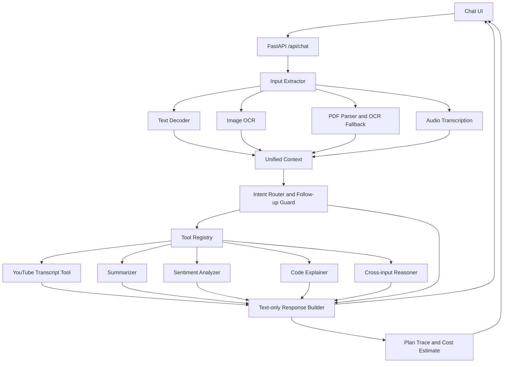

# Architecture Diagram

## Notes

- The extractor normalizes all supported inputs into text plus source metadata.
- The intent router applies the mandatory follow-up rule before running task tools.
- YouTube transcript fetching is triggered when a URL appears in any input and the query asks to use that URL.
- Audio transcription and open-ended conversational answers use OpenAI when `OPENAI_API_KEY` is configured.
- OCR uses Tesseract through `pytesseract`; the Dockerfile installs the Tesseract binary.

